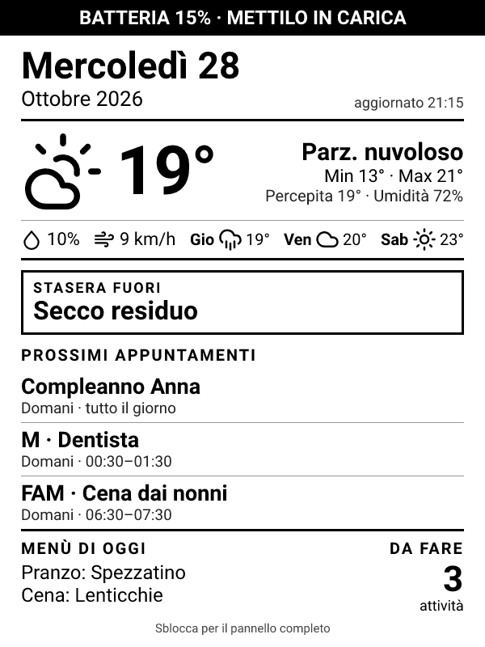

# Kinboard

**Trasforma un vecchio Kindle in un pannello da frigorifero.** Calendario, meteo, cose da fare, menù della settimana e promemoria della raccolta differenziata — su e-ink, con settimane di batteria.

[English](README.md)

| Salvaschermo (Kindle bloccato) | Pannello (Kindle sbloccato) | Meteo |
|---|---|---|
|  |  |  |

- **Bloccato:** il salvaschermo del Kindle diventa il pannello e si aggiorna da solo ogni 15 minuti (di notte riposa).
- **Sbloccato:** il browser apre il pannello interattivo: oggi, meteo, agenda, da fare (le attività si spuntano dal Kindle) e menù della settimana.
- **Tutto è facoltativo e configurabile:** usi solo le parti che ti servono, in italiano o in inglese.

## Come funziona

```
 Calendari (iCal / Google / Home Assistant)      ┐
 Da fare (Google Tasks / Todoist / Home Assistant) ├──▶ server Kinboard ──▶ /api/screen  PNG del salvaschermo
 Meteo (Open-Meteo, senza chiave)                 │   (Vercel o Docker) ──▶ /          pannello web
 Menù e differenziata (file di configurazione)     ┘                     ──▶ /api/data  JSON
                                                                               ▲
                                        Kindle: kindle/kinboard/watcher.sh ────┘
```

Tutte le credenziali stanno sul server; il Kindle conosce solo l'indirizzo del server e un token.

## Prova veloce (dati di esempio, nessun account)

```bash
git clone https://github.com/gombare/kinboard && cd kinboard
npm install
echo '{ "demo": true, "language": "it", "timezone": "Europe/Rome" }' > kinboard.config.json
KINBOARD_TOKEN=demo npm start
# apri http://localhost:8080/?token=demo  — e http://localhost:8080/api/screen?token=demo
```

## 1. Avvia il server

### Vercel (gratis, niente da mantenere)

1. Fai il fork del repository e importalo su Vercel (framework *Other*, nessun comando di build).
2. Variabili d'ambiente:
   - `KINBOARD_TOKEN` — una stringa casuale lunga (`openssl rand -hex 16`);
   - `KINBOARD_CONFIG` — tutta la configurazione JSON su una riga;
   - i segreti richiamati nella configurazione come `${NOME}` (indirizzi dei calendari, chiavi…).
3. Pubblica: Kinboard sarà su `https://<progetto>.vercel.app`.

### Docker (server di casa, NAS, Raspberry Pi…)

```bash
cp kinboard.config.example.json kinboard.config.json   # modificalo
cp .env.example .env                                     # imposta KINBOARD_TOKEN e i segreti
docker compose up -d --build
```

Il Kindle deve raggiungere il server: sulla stessa Wi-Fi usa l'indirizzo locale (`http://192.168.1.10:8080`); da fuori casa, per esempio Tailscale o un reverse proxy.

## 2. Configura

**Il modo più semplice: `npm run setup`.** Ti fa qualche domanda — la città (trova da solo coordinate e fuso orario), i link dei calendari, il servizio per le cose da fare, il menù, la differenziata, l'indirizzo del server — e crea `kinboard.config.json`, `.env` (i segreti, leggibile solo da te) e una cartella `kindle-ready/` da copiare così com'è sul Kindle. Stampa anche le variabili da incollare su Vercel.

Se preferisci a mano, ecco come è fatto il file.


La configurazione è un file JSON (`kinboard.config.json`, oppure la variabile `KINBOARD_CONFIG`). Ogni testo può richiamare una variabile d'ambiente come `${NOME}`. L'esempio completo è in [`kinboard.config.example.json`](kinboard.config.example.json); la tabella di tutte le opzioni è nel [README inglese](README.md#2-configure).

Esempio italiano:

```json
{
  "language": "it",
  "timezone": "Europe/Rome",
  "location": { "name": "Roma", "latitude": 41.89, "longitude": 12.49 },
  "calendars": [
    { "label": "M", "ics": "${CALENDARIO_MIO}" },
    { "label": "FAM", "ics": "${CALENDARIO_FAMIGLIA}" }
  ],
  "google": { "url": "${GOOGLE_SCRIPT_URL}", "key": "${GOOGLE_SCRIPT_KEY}", "calendars": false },
  "menu": {
    "labels": ["Pranzo", "Cena"],
    "weeks": [{ "mon": ["Legumi", "Carne bianca"], "tue": ["Formaggio", "Pesce"] }]
  },
  "waste": {
    "schedule": { "mon": ["Organico"], "tue": ["Carta"], "thu": ["Secco residuo"], "fri": ["Organico", "Vetro"], "sat": ["Plastica", "Alluminio"] }
  }
}
```

### Calendari

La fonte più semplice è un **indirizzo iCal** (sola lettura):

- **Google Calendar:** Impostazioni → il calendario → *Integra calendario* → **Indirizzo segreto in formato iCal**;
- **iCloud:** app Calendario → condividi → *Calendario pubblico*;
- **Outlook:** Impostazioni → Calendario → Calendari condivisi → *Pubblica un calendario* → link ICS;
- qualsiasi altro servizio che esporta `.ics`.

Tieni segreti questi indirizzi (mettili nelle variabili d'ambiente).

### Collegamento Google (Google Tasks, compleanni, spuntare le attività)

[`apps-script/Code.gs`](apps-script/Code.gs) gira **nel tuo account Google**:

1. Crea un progetto su [script.google.com](https://script.google.com) e incolla `Code.gs`.
2. *Servizi* (+): aggiungi **Google Tasks API** e, per i compleanni, **Google Calendar API**.
3. Modifica `CALENDARS`, `BIRTHDAYS` e `TASK_LIST` in cima al file, esegui **`setup`** e autorizza. Copia la **KEY** dal registro di esecuzione.
4. *Esegui il deployment → Nuovo deployment → App web*, esegui come **Me**, accesso **Chiunque**. Copia l'URL `/exec`.
5. Nella configurazione: `"google": { "url": "${GOOGLE_SCRIPT_URL}", "key": "${GOOGLE_SCRIPT_KEY}" }`.

### Todoist e Home Assistant

- **Todoist:** Impostazioni → Integrazioni → Sviluppatore → token API; `"tasks": { "provider": "todoist", "token": "${TODOIST_TOKEN}" }`.
- **Home Assistant:** Profilo → Sicurezza → *Token di accesso a lunga durata*; calendari `calendar.*`, lista `todo.*`.

## A cosa serve il jailbreak (e cosa funziona senza)

Un Kindle normale permette solo di *aprire* il pannello nel browser. Tutto il resto lo decide il software di Amazon: dopo qualche minuto lo schermo va in sospensione e mostra una copertina o una pubblicità, e una pagina web non può impedirlo né disegnare sul salvaschermo.

| | Senza jailbreak | Con jailbreak |
|---|---|---|
| Pannello interattivo nel browser | ✅ (segnalibro) | ✅ si apre da solo allo sblocco |
| Pannello visibile mentre il Kindle dorme | ❌ copertina o pubblicità | ✅ il salvaschermo *è* il pannello |
| Aggiornamento ogni 15 minuti, pausa di notte | ❌ | ✅ |
| Avviso di batteria scarica sullo schermo | ❌ | ✅ |
| Durata della batteria | breve: schermo e Wi-Fi sempre accesi | molto più lunga: il Kindle dorme tra un aggiornamento e l'altro |

Il jailbreak serve a far girare sul Kindle **un piccolo script di Kinboard** (`kindle/kinboard/watcher.sh`) che:

1. ascolta gli eventi del Kindle "bloccato / sbloccato / va in sospensione / si è svegliato";
2. scarica dal tuo server l'immagine del pannello e la disegna a tutto schermo con `eips` (lo strumento del Kindle per disegnare sull'e-ink), subito dopo il salvaschermo di Amazon;
3. imposta una sveglia per aggiornare l'immagine mentre il Kindle dorme (tranne di notte);
4. invia il livello della batteria, così l'immagine avvisa quando è scarica;
5. allo sblocco apre il pannello nel browser (blocca e sblocca subito per tornare al Kindle normale).

Non tocca i libri né l'account Amazon e si ferma quando il Kindle si riavvia. Tieni il Wi-Fi spento durante il jailbreak ed evita gli aggiornamenti del firmware: un aggiornamento può annullarlo (in quel caso ripeti l'hotfix).

## 3. Prepara il Kindle

> Provato su Kindle 10ª generazione (2019, firmware 5.17.1). Il jailbreak è a tuo rischio.

1. Fai il **jailbreak** con la guida ufficiale di [kindlemodding.org](https://kindlemodding.org) (WinterBreak sui firmware recenti) e installa l'hotfix, così gli *scriptlet* `.sh` nella cartella `documents` compaiono nella libreria.
2. Collega il Kindle via USB e copia `kindle/kinboard/` in `kinboard/` (radice del Kindle) e `kindle/documents/*.sh` in `documents/`.
3. Modifica `kinboard/config.sh`: `KINBOARD_URL` e `TOKEN` (lo stesso di `KINBOARD_TOKEN`).
4. Espelli, apri la libreria e tocca **Kinboard - start**. Blocca il Kindle: compare il pannello.
5. Sbloccalo per aprire il pannello interattivo. Blocca e sblocca entro 8 secondi per uscire e usare il Kindle normalmente. **Kinboard - stop** ripristina il salvaschermo originale.

Il log è in `kinboard/log.txt`. Dopo un riavvio del Kindle tocca di nuovo *Kinboard - start*.

Solo il pannello, senza jailbreak? Apri `https://tuo-server/?token=IL_TUO_TOKEN` nel browser del Kindle e salvalo nei segnalibri.

## Domande frequenti

**È davvero configurabile?** Sì: calendari, lista delle cose da fare, meteo, menù, differenziata, sezioni del salvaschermo e schede del pannello si scelgono in un solo file JSON, senza toccare il codice. Restano fissi l'impaginazione (pensata per schermi e-ink 600×800) e le fonti supportate: per aggiungerne una nuova (per esempio Microsoft To Do) serve un piccolo modulo in `src/sources/`.

**Quali Kindle?** Provato sul Kindle 10ª generazione (2019). Altri modelli con jailbreak e schermo 600×800 dovrebbero funzionare.

**Serve la password di Google?** No. Gli indirizzi iCal sono link di sola lettura; lo script Google gira nel tuo account e risponde solo a chi ha la sua chiave.

**Funziona senza server?** No, qualcosa deve creare l'immagine e leggere i dati. Il piano gratuito di Vercel basta per un Kindle.

## Sicurezza e limiti

- Ogni chiamata richiede `KINBOARD_TOKEN`; lo script Google ha una sua chiave e mostra solo i calendari e la lista che scegli.
- Non pubblicare mai `kinboard.config.json`, `.env` o `kindle-ready/` (sono già nel `.gitignore`).
- Il token viaggia nell'indirizzo, quindi può comparire nei log del servizio di hosting: usa un valore lungo e casuale e cambialo se condividi quei log.
- I link iCal "segreti" danno accesso in lettura a tutto il calendario a chiunque li abbia: tienili solo in `.env` o nelle variabili di Vercel.
- Il browser del Kindle mostra sempre la barra degli indirizzi; il risveglio programmato dalla sospensione profonda è sperimentale.

## Rifarlo con un assistente AI

[`PROMPT.md`](PROMPT.md) è un prompt pronto da incollare in Claude o ChatGPT: descrive tutto il progetto, compresi i dettagli del Kindle scoperti per tentativi, per ricrearlo da zero o farne una versione tua.

## Licenza

MIT. Icone meteo: [Lucide](https://lucide.dev) (ISC). Font: Roboto (OFL).
