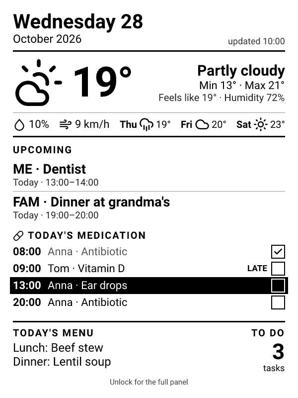
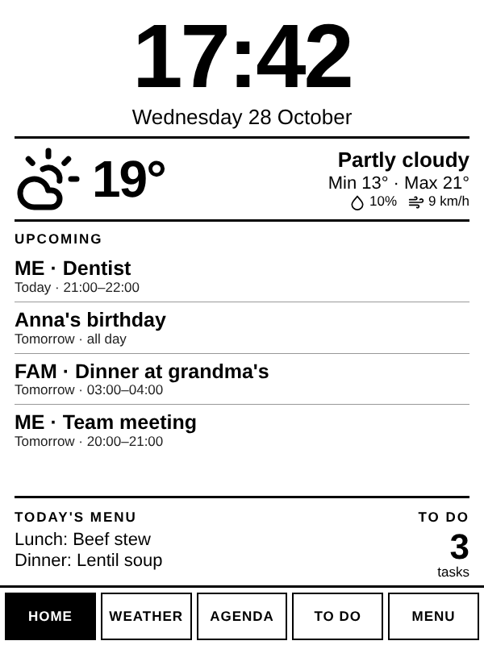
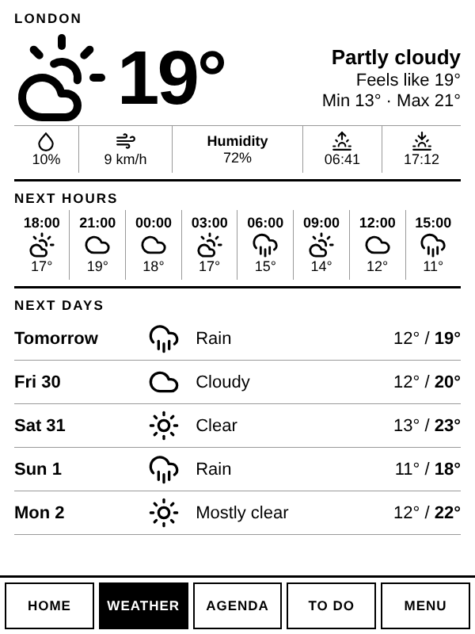

# Kinboard

**Turn an old Kindle into a fridge dashboard.** Calendar, weather, to-do list, medication, weekly meal plan and bin-day reminders — on e-ink, with weeks of battery life.

[Italiano](README.it.md)

| Screensaver (Kindle locked) | Panel (Kindle unlocked) | Weather |
|---|---|---|
|  |  |  |

- **Locked:** the Kindle's screensaver becomes the dashboard and refreshes itself every 15 minutes (it sleeps at night).
- **Unlocked:** the browser opens an interactive panel: today, weather, agenda, to-do (tick tasks off from the Kindle), today's medication doses and the week's menu.
- **Everything is optional and configurable:** use only the parts you need, in English or Italian (more languages welcome).

## How it works

```
 Calendars (iCal / Google / Home Assistant) ┐
 To-do (Google Tasks / Todoist / Home Assistant) ├──▶ Kinboard server ──▶ /api/screen  PNG for the screensaver
 Weather (Open-Meteo, no key needed)           │   (Vercel or Docker)  ──▶ /          web panel for the browser
 Menu and bin days (config file)               ┘                       ──▶ /api/data  JSON
                                                                              ▲
                                     Kindle: kindle/kinboard/watcher.sh ──────┘
```

The server holds every credential; the Kindle only knows the server address and a token.

## Quick start (demo, no accounts needed)

```bash
git clone https://github.com/gombare/kinboard && cd kinboard
npm install
echo '{ "demo": true, "language": "en" }' > kinboard.config.json
KINBOARD_TOKEN=demo npm start
# open http://localhost:8080/?token=demo  — and http://localhost:8080/api/screen?token=demo
```

`npm run preview -- out.png --lang it --time 2026-10-28T21:15 --battery 15` renders the screensaver offline.

## 1. Run the server

You need a place the Kindle can reach. Pick one:

### Vercel (free, nothing to maintain)

1. Fork this repository and import it in Vercel (framework: *Other*, no build command).
2. Add environment variables:
   - `KINBOARD_TOKEN` — a long random string (`openssl rand -hex 16`).
   - `KINBOARD_CONFIG` — the whole JSON configuration (see below), on one line.
   - any secret referenced from the configuration as `${NAME}` (calendar URLs, keys…).
3. Deploy. Your Kinboard lives at `https://<project>.vercel.app`.

### Docker (home server, NAS, Raspberry Pi…)

```bash
cp kinboard.config.example.json kinboard.config.json   # edit it
cp .env.example .env                                     # set KINBOARD_TOKEN and secrets
docker compose up -d --build
```

The Kindle must be able to reach the server: on the same Wi-Fi use the server's LAN address (`http://192.168.1.10:8080`); from outside, use something like Tailscale or a reverse proxy.

### Plain Node.js (20+)

`npm install && KINBOARD_TOKEN=… npm start` (port `PORT`, default 8080).

## 2. Configure

**Easiest: `npm run setup`.** It asks a few questions — town (it finds coordinates and time zone for you), calendar links, to-do service, menu, bin days, the address of your server — and writes `kinboard.config.json`, `.env` (secrets, readable only by you) and a ready-to-copy `kindle-ready/` folder for the Kindle. It also prints the variables to paste into Vercel. Run it again whenever you want to start over.

Prefer to edit by hand? Read on.


Configuration is a JSON file (`kinboard.config.json`, or the `KINBOARD_CONFIG` variable). Any string can reference an environment variable as `${NAME}`, so secrets stay out of the file. A full example is in [`kinboard.config.example.json`](kinboard.config.example.json).

| Key | What it does |
|---|---|
| `language` | `en` or `it` |
| `timezone` | IANA zone, e.g. `Europe/Rome` |
| `units` | `metric` or `imperial` |
| `location` | `{ "name", "latitude", "longitude" }` for the weather |
| `weather.enabled` | `false` hides the weather everywhere |
| `calendars` | list of `{ "label": "ME", "ics": "https://…" }` or `{ "label": "FAM", "homeassistant": "calendar.family" }` |
| `google` | `{ "url", "key", "calendars": true, "tasks": true }` — the optional Google bridge (below) |
| `homeassistant` | `{ "url": "http://homeassistant.local:8123", "token": "${HOMEASSISTANT_TOKEN}" }` |
| `tasks` | `{ "provider": "google" }`, `{ "provider": "todoist", "token", "filter": "today \| overdue" }` or `{ "provider": "homeassistant", "entity": "todo.shopping_list" }` |
| `menu` | `labels` (e.g. `["Lunch","Dinner"]`), `weeks` (one or more weeks that rotate from `startDate`), `overrides` by date |
| `medications` | `{ "homeassistant": "todo.medications" }` or `{ "items": [{ "who", "name", "times": ["08:00"], "until" }] }` — see [Medications](#medications) |
| `waste` | `schedule` by weekday; shown from `from` (default 20) until `until` (default 6) — in the evening the next day's collection |
| `screen.sections` | order and choice of `header`, `weather`, `waste`, `events`, `medications`, `footer` |
| `screen.maxEvents`, `screen.maxDoses`, `screen.lowBattery` | events (default 4, fewer when space runs out) and doses (default 4) on the screensaver, low-battery warning threshold (default 20 %) |
| `panel.views` | order and choice of `home`, `weather`, `agenda`, `tasks`, `medications`, `menu` |
| `daysAhead` | how many days of agenda to load (default 7) |
| `demo` | `true` shows sample data |

Sections and views without a data source are hidden automatically.

### Calendars

The simplest source is an **iCal address**, read-only:

- **Google Calendar:** Settings → the calendar → *Integrate calendar* → **Secret address in iCal format**.
- **iCloud:** Calendar app → share the calendar → *Public calendar* → copy the link.
- **Outlook.com / Microsoft 365:** Settings → Calendar → Shared calendars → *Publish a calendar* → ICS link.
- Nextcloud, Fastmail, Proton (share link), school or sports calendars… anything that exports `.ics`.

Keep these addresses secret (put them in environment variables).

### Google bridge (Google Tasks, birthdays, completing tasks)

iCal is read-only and has no Google Tasks. For that, [`apps-script/Code.gs`](apps-script/Code.gs) runs **inside your own Google account**:

1. Create a project at [script.google.com](https://script.google.com) and paste `Code.gs`.
2. *Services* (+): add **Google Tasks API**, and **Google Calendar API** if you want birthdays.
3. Edit `CALENDARS`, `BIRTHDAYS` and `TASK_LIST` at the top of the file, then run **`setup`** and authorise. Copy the **KEY** from the execution log.
4. *Deploy → New deployment → Web app*, execute as **Me**, access **Anyone**. Copy the `/exec` URL.
5. In the configuration: `"google": { "url": "${GOOGLE_SCRIPT_URL}", "key": "${GOOGLE_SCRIPT_KEY}" }`.

After editing the script: *Manage deployments → edit → New version* (the URL stays the same).

### Todoist

Settings → Integrations → Developer → API token, then `"tasks": { "provider": "todoist", "token": "${TODOIST_TOKEN}", "filter": "today | overdue" }`. Any [Todoist filter](https://todoist.com/help/articles/introduction-to-filters) works.

### Home Assistant

Profile → Security → *Long-lived access token*. Calendars use `calendar.*` entities, the to-do list a `todo.*` entity (e.g. the shopping list).

### Medications

The screensaver lists today's doses in time order: the next one is printed white on black, taken ones are ticked, missed ones say *late*. In the panel, the *Meds* tab lets you tick a dose off from the Kindle and shows the ongoing therapies.

- **Fixed list:** `"medications": { "items": [{ "who": "Anna", "name": "Vitamin D", "times": ["08:00"], "until": "2026-12-31" }] }` (`until` is optional). Doses cannot be ticked off.
- **Home Assistant (recommended):** create a to-do list (*Settings → Devices & services → Add integration → Local To-do*), then `"medications": { "homeassistant": "todo.medications" }`. Each open item is a therapy:
  - **name:** the medication, e.g. `Vitamin D`;
  - **description:** `Who | 08:00 20:00` — Kinboard appends ` | taken:2026-10-29 08:00` when a dose is ticked off;
  - **due date:** optional, the last day of the therapy.

  Because the list lives in Home Assistant, automations can use it too: a reminder with a *Taken* button on Telegram, a bot command to add a therapy, and so on. Completed items are ignored. The Italian `prese:` is understood as well.

## Why the jailbreak (and what works without it)

A stock Kindle only lets you *browse* to the panel. Amazon's software decides everything else: after a few minutes the screen goes to sleep and shows a cover or an ad, and a web page cannot stop that or draw on the sleep screen.

| | Without jailbreak | With jailbreak |
|---|---|---|
| Interactive panel in the browser | ✅ (bookmark the URL) | ✅ opens by itself when you unlock |
| Dashboard visible while the Kindle sleeps | ❌ cover or ads | ✅ the screensaver *is* the dashboard |
| Refresh every 15 minutes, quiet at night | ❌ | ✅ |
| Low-battery warning on screen | ❌ | ✅ |
| Battery life | short: screen and Wi-Fi stay on all the time | much longer: the Kindle sleeps between refreshes |

The jailbreak is what lets Kinboard run **its own small script** on the Kindle (`kindle/kinboard/watcher.sh`). The script:

1. listens for "screen locked / unlocked / going to sleep / woke up" events from the Kindle's power manager;
2. downloads the dashboard PNG from your server and draws it full-screen with `eips` (the Kindle's e-ink drawing tool) right after the Kindle shows its own screensaver;
3. sets a wake-up alarm so the image refreshes while the Kindle sleeps (skipping the night hours);
4. sends the battery level along, so the image can warn you when it is low;
5. opens the panel in the browser when you unlock (lock + unlock quickly to get the normal Kindle back).

It does not touch your books or your Amazon account and stops when the Kindle restarts. Keep Wi-Fi off during the jailbreak and avoid firmware updates afterwards: an update can remove it (run the hotfix again if that happens).

## 3. Set up the Kindle

> Tested on a Kindle 10th generation (2019, firmware 5.17.1). Jailbreaking is at your own risk and may void your warranty.

1. **Jailbreak** it following the official guide at [kindlemodding.org](https://kindlemodding.org) (WinterBreak for recent firmware) and install the hotfix, so that `.sh` *scriptlets* in the `documents` folder appear in the library.
2. Connect the Kindle by USB and copy:
   - `kindle/kinboard/` → `kinboard/` at the root of the Kindle drive;
   - `kindle/documents/*.sh` → `documents/`.
3. Edit `kinboard/config.sh`: `KINBOARD_URL` and `TOKEN` (same as `KINBOARD_TOKEN`).
4. Eject, open the library and tap **Kinboard - start**. Lock the Kindle: the dashboard appears.
5. Unlock to open the panel. Lock and unlock again within 8 seconds to leave the panel and use the Kindle normally. **Kinboard - stop** restores the normal screensaver.

The Kindle log is `kinboard/log.txt` (visible over USB). The watcher stops when the Kindle restarts: tap *Kinboard - start* again.

Want the panel only, without jailbreak? Open `https://your-server/?token=YOUR_TOKEN` in the Kindle's browser and bookmark it.

## Security

- Every API call needs `KINBOARD_TOKEN`. The panel reads it once from `?token=` and then keeps it on the device.
- The Google bridge has its own key and only exposes the calendars and the single task list you choose.
- Never commit `kinboard.config.json`, `.env` or `kindle-ready/` (all in `.gitignore`), and do not share screenshots of URLs that contain the token.
- The token travels in the URL (the Kindle's tools cannot send headers easily), so it can appear in your hosting provider's request logs: use a long random value and change it if you ever share those logs.
- iCal "secret" links give read access to the whole calendar to anyone who has them: keep them in `.env` or in Vercel's environment variables only.

## Limitations

- The Kindle browser always shows its address bar.
- The timed wake-up from deep sleep is experimental: if the screensaver stops refreshing overnight, the image updates at the next unlock. Reports and fixes welcome.
- Screensaver layout is designed for 600×800 screens.

## FAQ

**Is it really configurable?** Yes: calendars, to-do provider, weather, menu, bin days, which sections the screensaver shows and which tabs the panel has are all in one JSON file — no code changes. What is fixed: the layout is designed for 600×800 e-ink screens, and adding a brand-new data source (e.g. Microsoft To Do) means writing a small module in `src/sources/`.

**Which Kindles?** Tested on the Kindle 10th generation (2019). Other jailbreakable models with a 600×800 screen should work; larger screens show the image unscaled.

**Does it need my Google password?** No. iCal links are read-only URLs; the optional Google bridge runs inside your own Google account and only answers requests carrying its key.

**Can I run it without a server?** No, something must build the image and fetch your data. Vercel's free plan is enough for one Kindle.

## Development

```bash
npm test                     # unit tests (no network)
npm run preview -- out.png   # render the screensaver with sample data
```

Code layout: `src/` server (config, sources, renderer, HTTP handler), `api/` Vercel functions, `public/` web panel (ES5 for the Kindle browser), `kindle/` device scripts, `apps-script/` Google bridge.

Translations: add a block to `src/i18n.js`.

Want to rebuild it or make your own variant with an AI assistant? [`PROMPT.md`](PROMPT.md) is a ready-made prompt that describes the whole project, including the Kindle quirks.

## License

MIT. Weather icons: [Lucide](https://lucide.dev) (ISC). Font: Roboto (OFL).
